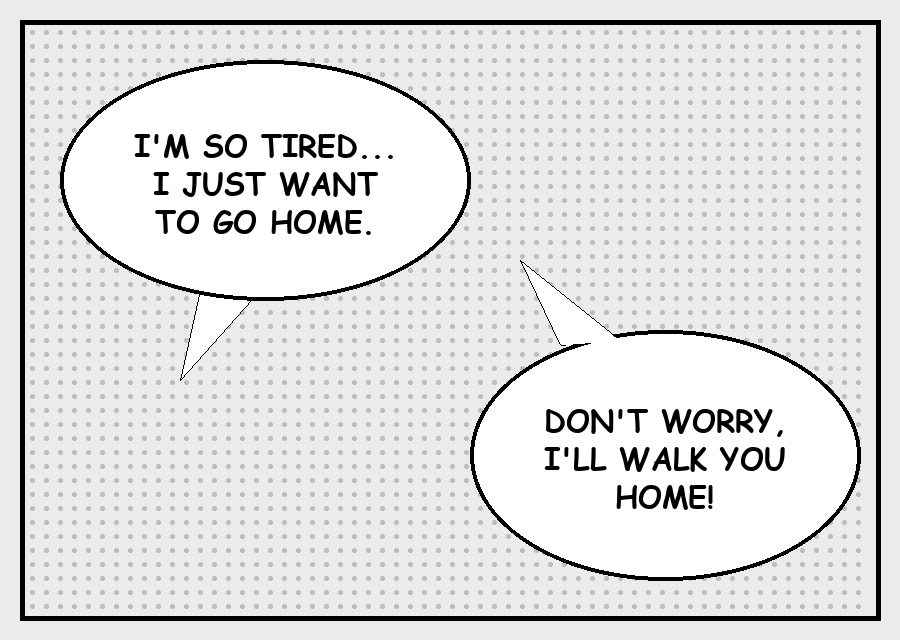
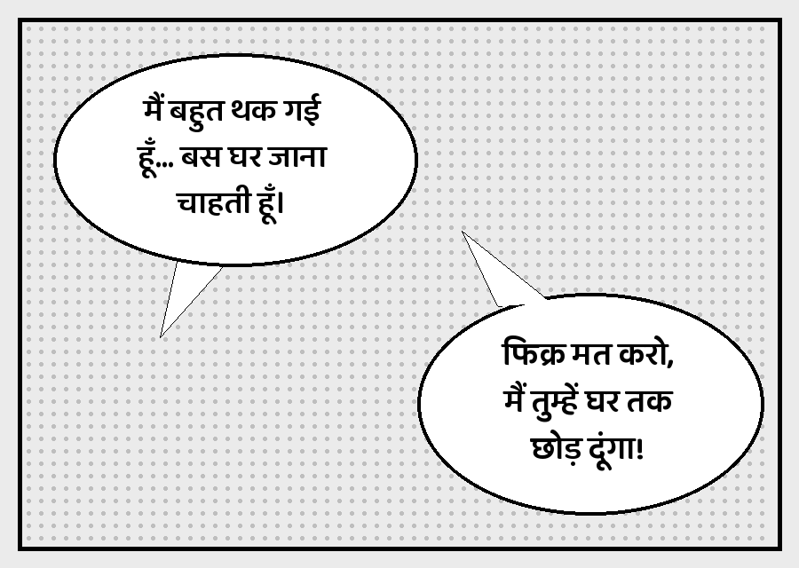
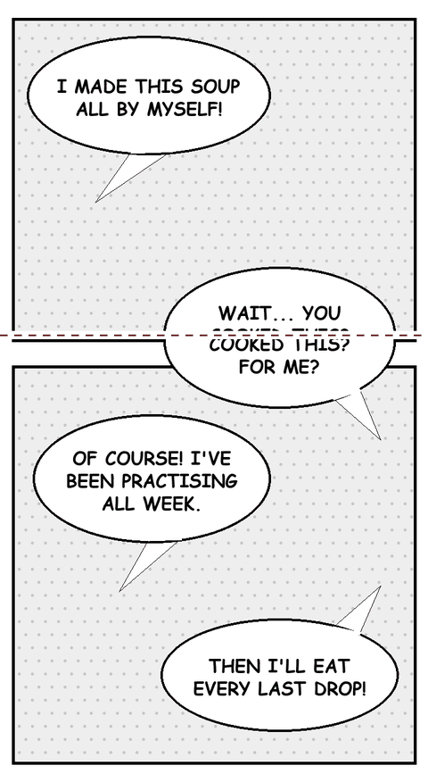
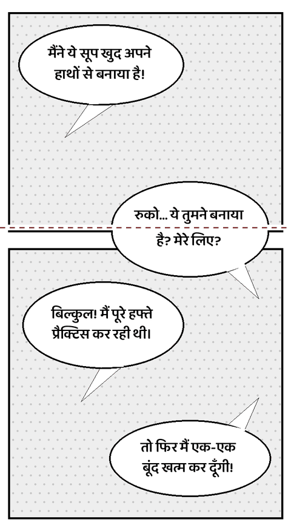
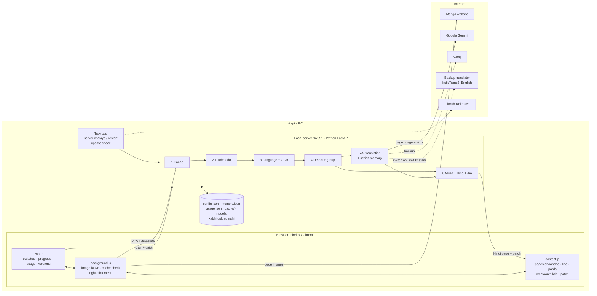
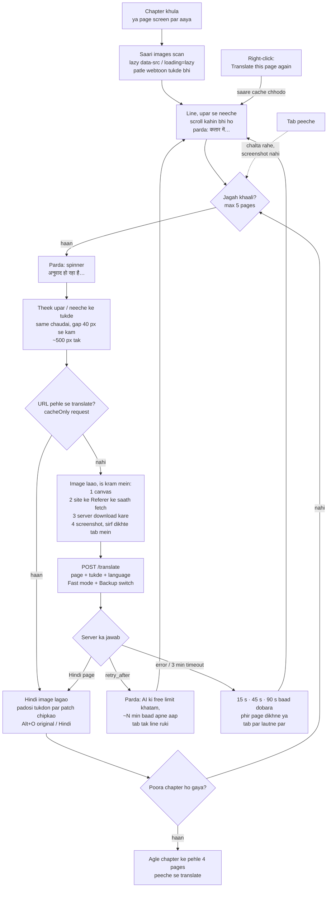
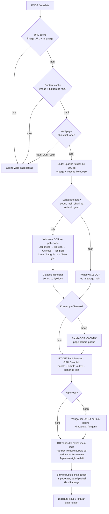
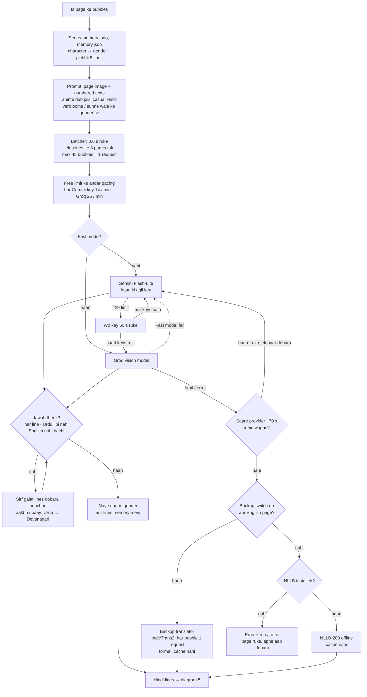
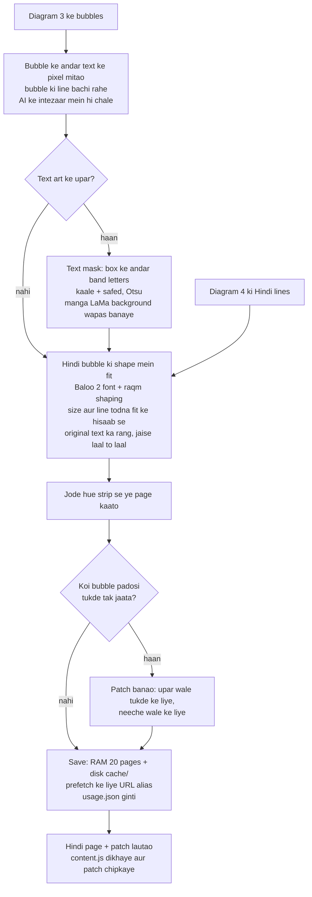

<div align="center">


# Manga Translator

**Manga, manhwa aur comics ko browser mein hi natural, casual Hindi mein padho.**

Japanese · Korean · Chinese · English → हिन्दी

<a href="https://github.com/jitendra205saini/Manga-Translator/releases/latest"></a>
<a href="https://www.python.org/downloads/"></a>
<a href="https://github.com/jitendra205saini/Manga-Translator/blob/main/README.hinglish.md#kya-chahiye"></a>
<a href="https://github.com/jitendra205saini/Manga-Translator/blob/main/README.hinglish.md#installation"></a>
<a href="https://github.com/jitendra205saini/Manga-Translator/blob/main/README.hinglish.md#installation"></a>
<a href="https://github.com/jitendra205saini/Manga-Translator/blob/main/README.hinglish.md#tech-stack"></a>
<a href="https://github.com/jitendra205saini/Manga-Translator/blob/main/LICENSE"></a>

[`manga`](https://github.com/topics/manga) [`manga-translator`](https://github.com/topics/manga-translator) [`manhwa`](https://github.com/topics/manhwa) [`comics`](https://github.com/topics/comics) [`translation`](https://github.com/topics/translation) [`hindi`](https://github.com/topics/hindi) [`ocr`](https://github.com/topics/ocr) [`gemini`](https://github.com/topics/gemini) [`groq`](https://github.com/topics/groq) [`llm`](https://github.com/topics/llm) [`browser-extension`](https://github.com/topics/browser-extension) [`firefox-extension`](https://github.com/topics/firefox-extension) [`chrome-extension`](https://github.com/topics/chrome-extension) [`fastapi`](https://github.com/topics/fastapi) [`python`](https://github.com/topics/python) [`opencv`](https://github.com/topics/opencv)

[English](README.md) | **Hinglish**

[Features](#features) · [Kaise kaam karta hai](#kaise-kaam-karta-hai) · [Installation](#installation) · [Use kaise karein](#use-kaise-karein) · [Configuration](#configuration) · [Troubleshooting](#troubleshooting)

</div>

---

<div align="center">

| Pehle | Baad mein |
|---|---|
|  |  |

*Ye demo page README ke liye banaya gaya hai. Left mein ladki bol rahi hai ("थक गई"), right mein ladka ("छोड़ दूंगा").*

| Webtoon: split bubble, before | After |
|---|---|
|  |  |

*Is README ke liye banaya demo, jise webtoon sites ki tarah laal line par do tasveeron mein kaata gaya hai. Beech wala bubble cut ke aar-paar hai; wo poora padha gaya aur dono tasveeron par sahi bana.*

</div>


## Overview

**Manga Translator** ek free tool hai jo aapke apne PC par chalta hai. Aap manga padhte ho aur ye saath-saath
pages translate karta jaata hai. Browser extension har page ko aapke PC par chal rahe ek chhote server ko bhejta hai.
Server text padhta hai, AI se roz ki bolchaal wali Hindi mein translate karta hai, purana text mitata hai aur
Hindi wapas bubble mein likh deta hai. Page aisa lagta hai jaise pehle se Hindi mein chhapa ho.

Ye shabd-ba-shabd translation nahi karta. Ye page ki image dekhkar samajhta hai ki **kaun bol raha hai**,
isliye Hindi mein gender sahi aata hai: ladki bole to *"मैं थक गई"*, ladka bole to *"मैं थक गया"*.

## Features

| Feature | Details |
|---|---|
| **Casual Hindi** | Anime dub jaisi bolchaal wali Hindi, shuddh ya kitabi Hindi nahi |
| **Gender ke hisaab se** | Verb bolne wale aur sunne wale ke gender se match karte hain |
| **Character memory** | Har series mein characters ka gender yaad rakhta hai (`memory.json`) |
| **4 languages** | Japanese, Korean, Chinese (Simplified / Traditional) aur English, Auto-detect ke saath |
| **ML bubble detection** | RT-DETR model bubbles, bubble ke andar ka text aur art ke upar ka text pehchanta hai, GPU par ~0.1 s per page |
| **Saaf typesetting** | Sirf text ke pixels mitata hai, art ko manga par tuned LaMa model se wapas banata hai aur Hindi comic font mein, original text ke rang mein, bubble ki shape mein fit karta hai |
| **Backup chain** | Gemini → Groq (Qwen vision model, image bhi dekhta hai) → local NLLB. Free limit khatam ho to bhi padhna nahi rukta |
| **Firefox aur Chrome** | Manifest V3 extension, kisi bhi site par chalta hai, "Always on for this site" option ke saath |
| **Tez padhai** | Aage ke pages pehle se, 5 pages ek saath, AI ke jawab ke dauraan hi text mitana, har series ki language yaad, aur disk cache |
| **Free limit bachata hai** | Ek AI request mein 3 pages tak, isliye roz ki free limit mein ~3 guna pages |
| **Poora chapter, kram se** | Chapter ka har page upar se neeche tak translate, aap kahin bhi scroll karo. Jo page baaki hai us par loading parda |
| **Tab chhodne par bhi** | Doosre tab par jaane par bhi translation chalta rehta hai |
| **Webtoon ke tukde** | Jo sites lambi patti ko kai tasveeron mein kaatti hain, wahan bubble do hisson mein bat jaata hai. Extension upar aur neeche ke tukde bhi bhejta hai, isliye kata bubble poora padha jaata hai aur dono tasveeron par sahi chipakta hai |
| **Behtar Korean / Chinese OCR** | Korean aur Chinese PaddleOCR v5 (ONNX) se, Japanese manga-ocr se |
| **Agla chapter pehle se** | Chapter khatam hote hi agle chapter ke pehle pages pehle se translate |
| **Dobara translate** | Page par right-click karke **Translate this page again**, cache chhod ke naya anuvaad |
| **Limit ka saaf message** | Saari free AI limit khatam ho to page par dikhta hai ki kab dobara shuru hoga, aur apne aap shuru hota hai. Popup mein aaj ka use aur Google ka reset time |
| **Kai Gemini keys** | Comma laga ke ek se zyada key daalo. Jis key ki limit khatam ho wo ruk jaati hai aur agli chalti hai |
| **Original / Hindi toggle** | **Alt+O** dabao, saare pages original aur phir Hindi mein badal jaate hain |
| **Local first** | `127.0.0.1` par chalta hai. API keys aapke PC par hi rehti hain, kabhi commit nahi hoti |

## Kaise kaam karta hai

Poora architecture paanch diagram mein: pehle poora system, phir har hissa detail mein. Aur zyada detail (page ki yatra sequence mein, page ki halat, cache, files) **[docs/ARCHITECTURE.md](docs/ARCHITECTURE.md)** mein hai.

### 1. Poora system

Internet wale dabbe ki calls ke alawa sab kuch aapke PC par chalta hai.



### 2. Browser extension



### 3. Server: cache, OCR aur detection



### 4. AI translation, limit aur backup



### 5. Hindi likhna aur page lautana



## Tech stack

| Hissa | Technology |
|---|---|
| Browser extension | JavaScript, Manifest V3 (Firefox 128+ / Chrome) |
| Server | Python 3.13, FastAPI, Uvicorn |
| OCR | Windows 11 ka built-in OCR (`winrt`), Japanese ke liye `manga-ocr` ONNX, Korean / Chinese ke liye PaddleOCR v5 ONNX |
| Bubble / text detection | `ogkalu/comic-text-and-bubble-detector` (RT-DETR-v2, ONNX Runtime + DirectML), OpenCV fallback |
| Inpainting | Manga-tuned LaMa (`ogkalu/lama-manga-onnx-dynamic`), OpenCV fallback |
| Translation | Google Gemini Flash-Lite, Groq (`openai/gpt-oss-120b`), Meta NLLB-200 600M (offline) |
| Hindi likhna | Pillow + libraqm / FriBiDi, Baloo 2 (Noto Sans Devanagari fallback) |

## Project structure

```
manga-translator/
├── extension/                 # Firefox / Chrome extension
│   ├── manifest.json
│   ├── background.js          # images laata hai, local server se baat karta hai
│   ├── content.js             # page par manga images dhoondhta hai, translation lagata hai
│   └── popup.html / popup.js  # ON/OFF, language, "hamesha ON" aur server status
├── server/
│   ├── server.py              # FastAPI app (POST /translate, GET /health)
│   ├── translator.py          # pipeline: OCR -> group -> bubbles -> translate -> render
│   ├── ocr_windows.py         # Windows OCR wrapper
│   ├── mangaocr.py            # manga-ocr (ONNX) for Japanese
│   ├── render.py              # bubble detection, text mitana aur Hindi likhna
│   ├── llm.py                 # Gemini / Groq prompts, backup chain, character memory
│   ├── nllb.py                # offline NLLB backup
│   ├── detector.py            # ML bubble / text detector (ONNX, DirectML GPU)
│   ├── inpaint.py             # art ke upar ke text ke liye LaMa inpainting
│   ├── config.example.json    # ise config.json naam se copy karke keys daalo
│   └── fonts/
├── SETUP.bat                  # ek baar ka setup
├── START.bat                  # one-click start
├── STOP.bat                   # stop the server
└── INSTALL_OCR_LANGUAGES.bat  # Windows OCR language packs install
```

## Installation

### Windows installer (aasaan tarika)

1. [Releases](https://github.com/jitendra205saini/Manga-Translator/releases) se `MangaTranslator-Setup.exe` download karke chalao. Admin ki zarurat nahi.
2. Installer apna Python aur AI models (~600 MB) `%LOCALAPPDATA%\Programs\Manga Translator` mein khud download karta hai. System mein aur kuch install nahi hota.
3. End mein ek page khulta hai jo batata hai ki extension Chrome, Edge ya Firefox mein kaise lagana hai.
4. Manga Translator ghadi ke paas system tray mein chalta hai. Icon pe right-click karo: status, API keys, restart, log aur update. Ye roz ek baar GitHub pe naya version dekhta hai aur ek click mein khud update ho jaata hai.
5. **Manga Translator** pehli baar chalane par ek page khulta hai, jahan free Gemini (aur chaho to Groq) key paste karni hai. Key baad mein extension popup se badal sakte ho.

Uninstall: *Settings > Apps > Manga Translator > Uninstall*. Server band hota hai aur poora folder (Python, models, cache, keys) hat jaata hai; bahar koi pip ya model cache nahi bachta. Browser extension browser se hi hatao.

Installer khud banana ho to [Inno Setup 6](https://jrsoftware.org/isinfo.php) install karke `installeruild.bat` chalao.

### Manual setup (developers)

### Kya chahiye

- Windows 11 (built-in OCR ke liye)
- Python 3.13, PyTorch installed ke saath. NVIDIA GPU zaroori nahi, wo sirf NLLB backup mein kaam aata hai.
- Firefox 128+ ya Chrome
- Free [Gemini API key](https://aistudio.google.com/apikey) aur/ya free [Groq API key](https://console.groq.com/keys)

### Steps

**1. OCR language packs install karo** (admin ke roop mein chalao)

```bat
INSTALL_OCR_LANGUAGES.bat
```

**2. Setup chalao.** Ye virtual environment banata hai, dependencies install karta hai, aur Hindi font,
Hindi ki matras sahi jodne wali FriBiDi DLL, ML detector aur LaMa models (~380 MB) aur NLLB model download karta hai.

```bat
SETUP.bat
```

**3. API keys daalo.** `server\config.example.json` ko `server\config.json` naam se copy karo aur keys paste karo:

```json
{
  "gemini": { "api_key": "AIza..." },
  "groq":   { "api_key": "gsk_..." }
}
```

> [!IMPORTANT]
> API keys kisi ko mat dikhana. `server/config.json` `.gitignore` mein hai, isliye kabhi commit nahi hoti.

**4. Extension load karo**

- **Chrome:** `chrome://extensions` kholo, *Developer mode* ON karo, *Load unpacked* dabao aur `extension` folder chuno.
- **Firefox:** `about:debugging#/runtime/this-firefox` kholo, *Load Temporary Add-on* dabao aur `extension/manifest.json` chuno.
  Phir extension popup kholke **"Grant site access first"** dabao.

> [!NOTE]
> Firefox band karne par temporary add-on hat jaata hai. Har restart ke baad dobara load karo, ya Mozilla se sign karwa ke permanently install karo.

## Use kaise karein

1. `START.bat` pe double-click karo (ya pehli baar ke baad desktop pe bana **Manga Translator** shortcut).
   Zarurat ho to ye setup khud karega, key na ho to maangega, aur server background mein chala dega.
   Band karna ho to `STOP.bat`.
2. Browser mein manga chapter kholo.
3. Extension icon dabao aur **ON** karo, ya **Alt+T** dabao.
4. Normal scroll karo. Translate hote waqt page par narangi border dikhega, phir Hindi wala page lag jaayega.

**Tips**

- **"Always on for this site"** tick karo, us site par apne aap chalega.
- **Auto** ki jagah language fix karoge to pages jaldi translate honge.
- Original page se milane ke liye **Alt+O** dabao (ya popup ka button).

## Configuration

`server/config.json`

| Key | Default | Matlab |
|---|---|---|
| `providers` | `["gemini", "groq", "nllb"]` | Translators kis order mein try honge |
| `gemini.api_key` | `""` | Aapki Gemini key (ya `GEMINI_API_KEY` environment variable) |
| `gemini.model` | Flash-Lite models | Ek model ya list. Ek busy ho to agla try hota hai |
| `groq.api_key` | `""` | Aapki Groq key (ya `GROQ_API_KEY`) |
| `groq.model` | `["qwen/qwen3.8-27b", "openai/gpt-oss-120b"]` | Ek model ya list, order mein try hote hain |
| `groq.vision_models` | `["qwen/qwen3.8-27b"]` | Jin models ko page image bhi milti hai, taaki backup mein bhi gender sahi aaye |
| `image_max_side` | `1024` | AI ko bheji image ka size. Chhota = kam tokens |
| `batch_pages` | `3` | Ek AI request mein zyaada se zyaada itne pages |
| `batch_wait` | `1.5` | Request bhejne se pehle aur pages ke liye kitne second ruke |

## Troubleshooting

| Dikkat | Hal |
|---|---|
| Popup mein server band dikhe | `START.bat` pe double-click karo |
| Hindi ki matras tooti dikhein | `SETUP.bat` dobara chalao, phir `check_setup.py` mein `Hindi shaping: OK (raqm)` aana chahiye |
| Pages English mein reh jaayein | Server window mein error dekho. Gemini ki free limit khatam ho sakti hai, tab Groq chalega |
| Kisi character ka gender galat | `server/memory.json` mein us character ko `"m"` ya `"f"` kar do |
| Log mein "model not found" | `config.json` mein model ka naam badlo |

Setup kabhi bhi check karne ke liye:

```bat
cd server
..\manga_env\Scripts\python.exe check_setup.py
```

Debug ke liye server log mein har page ki language, kaunsa provider chala aur har bubble ka gender
(`m` / `f` / `u`) dikhta hai. Aakhri 40 pages ka original aur translated `server/debug/` mein save hota hai.

## Kamiyan (Known limitations)

- Windows OCR bahut stylish, italic ya khade (vertical) text ko theek se nahi padhta. Aisi bubbles Gemini image se padh leta hai.
- LaMa inpainting CPU par chalta hai (art ke upar har text block ke liye ~0.3 se 1.5 s), kyunki ye DirectML par nahi chalta. Ye AI ke jawab ke intezaar ke saath chalta hai, isliye extra time kam lagta hai.
- Bahut chhoti bubbles mein Hindi chhoti aati hai, kyunki Hindi aksar English se lambi hoti hai.
- Gemini ki free tier mein roz ki request limit hai, jo Google AI Studio mein har project ke liye set hoti hai.

## Roadmap

- [x] ML bubble aur text detector (`comic-text-and-bubble-detector`)
- [x] Art ke upar text ke liye LaMa inpainting
- [x] AI requests ek saath, har page alag (page ~5-10 second)
- [x] Disk cache: dobara khole chapter par request kharch nahi
- [x] Comic style Devanagari font (Baloo 2)
- [x] Original / Hindi toggle (Alt+O)
- [x] Windows installer aur saaf uninstaller
- [x] System tray app, ek click auto-update
- [x] AI ne jo bubble khaali chhoda use dobara puchna
- [x] API key ka setup page (install ke waqt key nahi chahiye)
- [x] Sound effects mote comic style mein (धड़ाम!, थप!)
- [x] Popup mein aaj ka hisaab aur Gemini quota
- [x] Japanese ke liye `manga-ocr` (ONNX, bina PyTorch): khada text, furigana, stylish font
- [x] Korean / Chinese ke liye PaddleOCR v5
- [x] Signed Firefox add-on (hamesha installed, `installer/signed/manga-translator.xpi`)

## License

[MIT License](LICENSE) ke tahat. Saath ke fonts (Noto Sans Devanagari, Baloo 2) SIL Open Font License mein hain, aur download hone wale models Apache-2.0 mein.

## Acknowledgements

- Translation ke liye [Google Gemini](https://ai.google.dev/), [Groq](https://groq.com/) aur [Meta NLLB-200](https://huggingface.co/facebook/nllb-200-distilled-600M)
- Hindi fonts ke liye [Baloo 2](https://fonts.google.com/specimen/Baloo+2) aur [Noto Sans Devanagari](https://fonts.google.com/noto/specimen/Noto+Sans+Devanagari)
- Bubble aur text pehchanne ke liye [ogkalu/comic-text-and-bubble-detector](https://huggingface.co/ogkalu/comic-text-and-bubble-detector)
- Inpainting ke liye [LaMa](https://github.com/advimman/lama), [ogkalu ka manga par tuned ONNX model](https://huggingface.co/ogkalu/lama-manga-onnx-dynamic)
- Art par text ka mask aur text ka rang pakadne ka tarika [comic-translate](https://github.com/ogkalu2/comic-translate) (Apache-2.0) se, `inpaint.py` aur `render.py` mein
- Inspiration: [manga-image-translator](https://github.com/zyddnys/manga-image-translator), [BallonsTranslator](https://github.com/dmMaze/BallonsTranslator) aur [comic-translate](https://github.com/ogkalu2/comic-translate)

---

<div align="center">

Made by [jitendra205saini](https://github.com/jitendra205saini)

</div>
