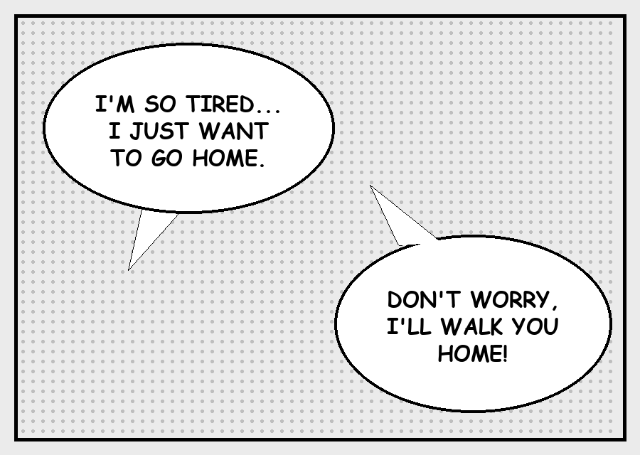
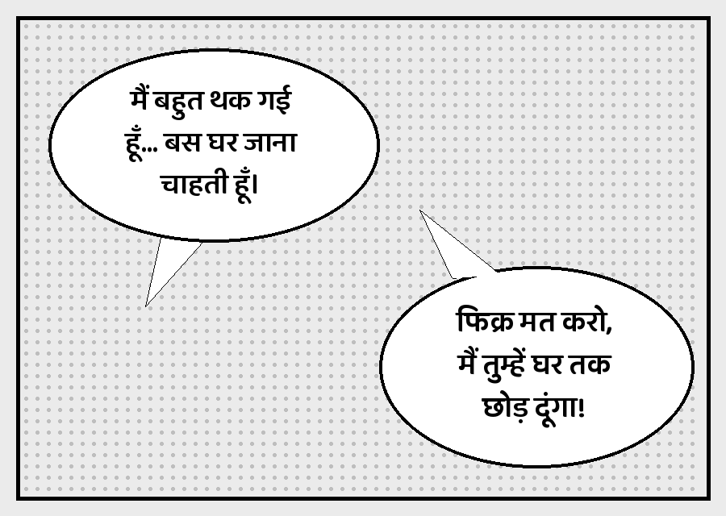
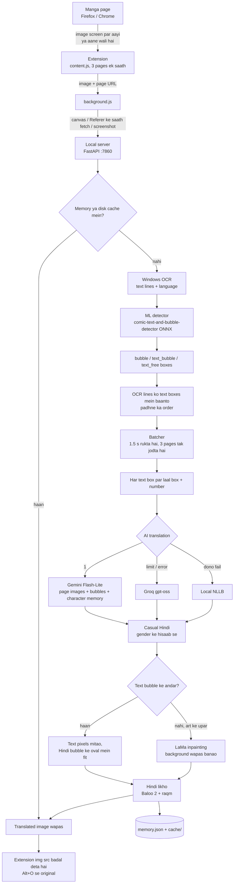

<div align="center">

# Manga Translator

**Manga, manhwa aur comics ko browser mein hi natural, casual Hindi mein padho.**

Japanese · Korean · Chinese · English → हिन्दी


[English](README.md) | **Hinglish**

[Features](#features) · [Kaise kaam karta hai](#kaise-kaam-karta-hai) · [Installation](#installation) · [Use kaise karein](#use-kaise-karein) · [Configuration](#configuration) · [Troubleshooting](#troubleshooting)

</div>

---

<div align="center">

| Pehle | Baad mein |
|---|---|
|  |  |

*Ye demo page README ke liye banaya gaya hai. Left mein ladki bol rahi hai ("थक गई"), right mein ladka ("छोड़ दूंगा").*

</div>


## Overview

**Manga Translator** ek free tool hai jo aapke apne PC par chalta hai. Aap manga padhte ho aur ye saath-saath
pages translate karta jaata hai. Browser extension har page ko aapke PC par chal rahe ek chhote server ko bhejta hai.
Server text padhta hai, AI se roz ki bolchaal wali Hindi mein translate karta hai, purana text mitata hai aur
Hindi wapas bubble mein likh deta hai. Page aisa lagta hai jaise pehle se Hindi mein chhapa ho.

Ye shabd-ba-shabd translation nahi karta. Ye page ki image dekhkar samajhta hai ki **kaun bol raha hai**,
isliye Hindi mein gender sahi aata hai: ladki bole to *"मैं थक गई"*, ladka bole to *"मैं थक गया"*.

## Features

| Feature | Details |
|---|---|
| **Casual Hindi** | Anime dub jaisi bolchaal wali Hindi, shuddh ya kitabi Hindi nahi |
| **Gender ke hisaab se** | Verb bolne wale aur sunne wale ke gender se match karte hain |
| **Character memory** | Har series mein characters ka gender yaad rakhta hai (`memory.json`) |
| **4 languages** | Japanese, Korean, Chinese (Simplified / Traditional) aur English, Auto-detect ke saath |
| **ML bubble detection** | RT-DETR model bubbles, bubble ke andar ka text aur art ke upar ka text pehchanta hai, GPU par ~0.1 s per page |
| **Saaf typesetting** | Sirf text ke pixels mitata hai, art ko LaMa inpainting se wapas banata hai aur Hindi comic font mein bubble ki shape mein fit karta hai |
| **Backup chain** | Gemini → Groq → local NLLB. Free limit khatam ho to bhi padhna nahi rukta |
| **Firefox aur Chrome** | Manifest V3 extension, kisi bhi site par chalta hai, "is site par hamesha ON" option ke saath |
| **Tez padhai** | Aage ke pages pehle se translate karta hai, 3 pages ek saath, aur results disk par cache karta hai |
| **Free limit bachata hai** | Ek AI request mein 3 pages tak, isliye roz ki free limit mein ~3 guna pages |
| **Original / Hindi toggle** | **Alt+O** dabao, saare pages original aur phir Hindi mein badal jaate hain |
| **Local first** | `127.0.0.1` par chalta hai. API keys aapke PC par hi rehti hain, kabhi commit nahi hoti |

## Kaise kaam karta hai



## Tech stack

| Hissa | Technology |
|---|---|
| Browser extension | JavaScript, Manifest V3 (Firefox 128+ / Chrome) |
| Server | Python 3.13, FastAPI, Uvicorn |
| OCR | Windows 11 ka built-in OCR (`winrt`) |
| Bubble / text detection | `ogkalu/comic-text-and-bubble-detector` (RT-DETR-v2, ONNX Runtime + DirectML), OpenCV fallback |
| Inpainting | LaMa (`Carve/LaMa-ONNX`), OpenCV fallback |
| Translation | Google Gemini Flash-Lite, Groq (`openai/gpt-oss-120b`), Meta NLLB-200 600M (offline) |
| Hindi likhna | Pillow + libraqm / FriBiDi, Baloo 2 (Noto Sans Devanagari fallback) |

## Project structure

```
manga-translator/
├── extension/                 # Firefox / Chrome extension
│   ├── manifest.json
│   ├── background.js          # images laata hai, local server se baat karta hai
│   ├── content.js             # page par manga images dhoondhta hai, translation lagata hai
│   └── popup.html / popup.js  # ON/OFF, language, "hamesha ON" aur server status
├── server/
│   ├── server.py              # FastAPI app (POST /translate, GET /health)
│   ├── translator.py          # pipeline: OCR -> group -> bubbles -> translate -> render
│   ├── ocr_windows.py         # Windows OCR wrapper
│   ├── render.py              # bubble detection, text mitana aur Hindi likhna
│   ├── llm.py                 # Gemini / Groq prompts, backup chain, character memory
│   ├── nllb.py                # offline NLLB backup
│   ├── detector.py            # ML bubble / text detector (ONNX, DirectML GPU)
│   ├── inpaint.py             # art ke upar ke text ke liye LaMa inpainting
│   ├── config.example.json    # ise config.json naam se copy karke keys daalo
│   └── fonts/
├── SETUP.bat                  # ek baar ka setup
├── START_SERVER.bat           # local server chalao
└── INSTALL_OCR_LANGUAGES.bat  # Windows OCR language packs install
```

## Installation

### Kya chahiye

- Windows 11 (built-in OCR ke liye)
- Python 3.13, PyTorch installed ke saath. NVIDIA GPU zaroori nahi, wo sirf NLLB backup mein kaam aata hai.
- Firefox 128+ ya Chrome
- Free [Gemini API key](https://aistudio.google.com/apikey) aur/ya free [Groq API key](https://console.groq.com/keys)

### Steps

**1. OCR language packs install karo** (admin ke roop mein chalao)

```bat
INSTALL_OCR_LANGUAGES.bat
```

**2. Setup chalao.** Ye virtual environment banata hai, dependencies install karta hai, aur Hindi font,
Hindi ki matras sahi jodne wali FriBiDi DLL, ML detector aur LaMa models (~380 MB) aur NLLB model download karta hai.

```bat
SETUP.bat
```

**3. API keys daalo.** `server\config.example.json` ko `server\config.json` naam se copy karo aur keys paste karo:

```json
{
  "gemini": { "api_key": "AIza..." },
  "groq":   { "api_key": "gsk_..." }
}
```

> [!IMPORTANT]
> API keys kisi ko mat dikhana. `server/config.json` `.gitignore` mein hai, isliye kabhi commit nahi hoti.

**4. Extension load karo**

- **Chrome:** `chrome://extensions` kholo, *Developer mode* ON karo, *Load unpacked* dabao aur `extension` folder chuno.
- **Firefox:** `about:debugging#/runtime/this-firefox` kholo, *Load Temporary Add-on* dabao aur `extension/manifest.json` chuno.
  Phir extension popup kholke **"Pehle permission do"** dabao.

> [!NOTE]
> Firefox band karne par temporary add-on hat jaata hai. Har restart ke baad dobara load karo, ya Mozilla se sign karwa ke permanently install karo.

## Use kaise karein

1. Server chalao:
   ```bat
   START_SERVER.bat
   ```
2. Browser mein manga chapter kholo.
3. Extension icon dabao aur **ON** karo, ya **Alt+T** dabao.
4. Normal scroll karo. Translate hote waqt page par narangi border dikhega, phir Hindi wala page lag jaayega.

**Tips**

- **"Is site par hamesha ON"** tick karo, us site par apne aap chalega.
- **Auto** ki jagah language fix karoge to pages jaldi translate honge.
- Original page se milane ke liye **Alt+O** dabao (ya popup ka button).

## Configuration

`server/config.json`

| Key | Default | Matlab |
|---|---|---|
| `providers` | `["gemini", "groq", "nllb"]` | Translators kis order mein try honge |
| `gemini.api_key` | `""` | Aapki Gemini key (ya `GEMINI_API_KEY` environment variable) |
| `gemini.model` | Flash-Lite models | Ek model ya list. Ek busy ho to agla try hota hai |
| `groq.api_key` | `""` | Aapki Groq key (ya `GROQ_API_KEY`) |
| `groq.model` | `openai/gpt-oss-120b` | Groq model ka naam |
| `groq.vision` | `false` | Groq ko page image bhi bhejo (vision model chahiye) |
| `image_max_side` | `1024` | AI ko bheji image ka size. Chhota = kam tokens |
| `batch_pages` | `3` | Ek AI request mein zyaada se zyaada itne pages |
| `batch_wait` | `1.5` | Request bhejne se pehle aur pages ke liye kitne second ruke |

## Troubleshooting

| Dikkat | Hal |
|---|---|
| Popup mein server band dikhe | `START_SERVER.bat` chalao aur uski window khuli rakho |
| Hindi ki matras tooti dikhein | `SETUP.bat` dobara chalao, phir `check_setup.py` mein `Hindi shaping: OK (raqm)` aana chahiye |
| Pages English mein reh jaayein | Server window mein error dekho. Gemini ki free limit khatam ho sakti hai, tab Groq chalega |
| Kisi character ka gender galat | `server/memory.json` mein us character ko `"m"` ya `"f"` kar do |
| Log mein "model not found" | `config.json` mein model ka naam badlo |

Setup kabhi bhi check karne ke liye:

```bat
cd server
..\manga_env\Scripts\python.exe check_setup.py
```

Debug ke liye server log mein har page ki language, kaunsa provider chala aur har bubble ka gender
(`m` / `f` / `u`) dikhta hai. Aakhri 40 pages ka original aur translated `server/debug/` mein save hota hai.

## Kamiyan (Known limitations)

- Windows OCR bahut stylish, italic ya khade (vertical) text ko theek se nahi padhta. Aisi bubbles Gemini image se padh leta hai.
- LaMa inpainting CPU par chalta hai (art ke upar har text block ke liye ~2 s), kyunki ye DirectML par nahi chalta.
- Bahut chhoti bubbles mein Hindi chhoti aati hai, kyunki Hindi aksar English se lambi hoti hai.
- Gemini ki free tier mein roz ki request limit hai, jo Google AI Studio mein har project ke liye set hoti hai.

## Roadmap

- [x] ML bubble aur text detector (`comic-text-and-bubble-detector`)
- [x] Art ke upar text ke liye LaMa inpainting
- [x] Ek AI request mein kai pages, taaki free limit zyaada chale
- [x] Disk cache: dobara khole chapter par request kharch nahi
- [x] Comic style Devanagari font (Baloo 2)
- [x] Original / Hindi toggle (Alt+O)
- [ ] Behtar OCR: Japanese ke liye `manga-ocr`, English / Korean / Chinese ke liye PaddleOCR
- [ ] Signed Firefox add-on (permanent install)

## License

[MIT License](LICENSE) ke tahat. Saath ke fonts (Noto Sans Devanagari, Baloo 2) SIL Open Font License mein hain, aur download hone wale models Apache-2.0 mein.

## Acknowledgements

- Translation ke liye [Google Gemini](https://ai.google.dev/), [Groq](https://groq.com/) aur [Meta NLLB-200](https://huggingface.co/facebook/nllb-200-distilled-600M)
- Hindi fonts ke liye [Baloo 2](https://fonts.google.com/specimen/Baloo+2) aur [Noto Sans Devanagari](https://fonts.google.com/noto/specimen/Noto+Sans+Devanagari)
- Bubble aur text pehchanne ke liye [ogkalu/comic-text-and-bubble-detector](https://huggingface.co/ogkalu/comic-text-and-bubble-detector)
- Inpainting ke liye [LaMa](https://github.com/advimman/lama) ([Carve ka ONNX version](https://huggingface.co/Carve/LaMa-ONNX))
- Inspiration: [manga-image-translator](https://github.com/zyddnys/manga-image-translator), [BallonsTranslator](https://github.com/dmMaze/BallonsTranslator) aur [comic-translate](https://github.com/ogkalu2/comic-translate)

---

<div align="center">

Made by [jitendra205saini](https://github.com/jitendra205saini)

</div>
