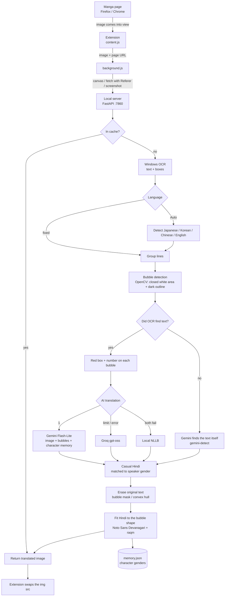

# Manga Translator (JA / KO / ZH / EN -> casual Hindi)

## Description

**Manga Translator** is a free, locally hosted tool that translates manga, manhwa and comic pages into
**casual, everyday Hindi** while you read them in the browser. The Hindi is drawn directly onto the image,
so the page looks as if it had been published in Hindi.

- Supports Japanese, Korean, Chinese and English pages
- **Gender-aware** Hindi: verbs match the speaker ("मैं थक गई" for a girl, "मैं थक गया" for a boy)
- Natural spoken Hindi instead of formal, bookish Hindi
- Erases the original text and fits the Hindi inside the speech bubble
- Works in Firefox and Chrome, on any site

Translation is done by Gemini, which looks at the page image to work out who is speaking.
If Gemini is unavailable it falls back to Groq, and if both fail it uses a local NLLB model offline.

**Topics / Tags:** `manga` `manga-translator` `manhwa` `comics` `translation` `hindi` `ocr` `gemini` `groq` `llm`
`browser-extension` `firefox-extension` `chrome-extension` `fastapi` `python` `opencv`

## How it works

## Requirements

- Windows 11 (uses the built-in Windows OCR)
- Python 3.13 with PyTorch already installed (an NVIDIA GPU is optional; it is used only for the NLLB fallback)
- Firefox 128+ or Chrome
- A free Gemini API key and/or a free Groq API key

## One-time setup

1. Run `INSTALL_OCR_LANGUAGES.bat` as administrator. This installs the Windows OCR language packs.
2. Run `SETUP.bat`. This creates the virtual environment, installs the dependencies and downloads the font, the FriBiDi DLL used for correct Hindi shaping, and the NLLB model.
3. Get your API keys (both are free):
   - Gemini: https://aistudio.google.com/apikey -> Create API key
   - Groq: https://console.groq.com/keys -> Create API Key

   Copy `server\config.example.json` to `server\config.json` and paste your keys into it.
   Never share your keys. `config.json` is listed in `.gitignore`, so it is never pushed.
4. Load the extension:
   - **Chrome:** `chrome://extensions` -> enable Developer mode -> Load unpacked -> select the `extension` folder
   - **Firefox:** `about:debugging#/runtime/this-firefox` -> Load Temporary Add-on -> select `extension\manifest.json`,
     then click "Pehle permission do" in the extension popup to grant site access

## Every time

1. Run `START_SERVER.bat`.
2. Open a manga chapter, click the extension icon and switch it ON (or press **Alt+T**).
   - Tick "Is site par hamesha ON" to turn it on automatically for that site.
   - Choosing a fixed language instead of Auto makes pages translate faster.

## Debugging

- The server log shows, for each page, the detected language, the provider used (gemini / groq / nllb),
  the gender detected for each bubble (m / f / u) and the translation.
- Character genders are remembered per series in `server\memory.json`. Edit it if one is wrong.
- The original and translated versions of the last 40 pages are saved in `server\debug\`.
