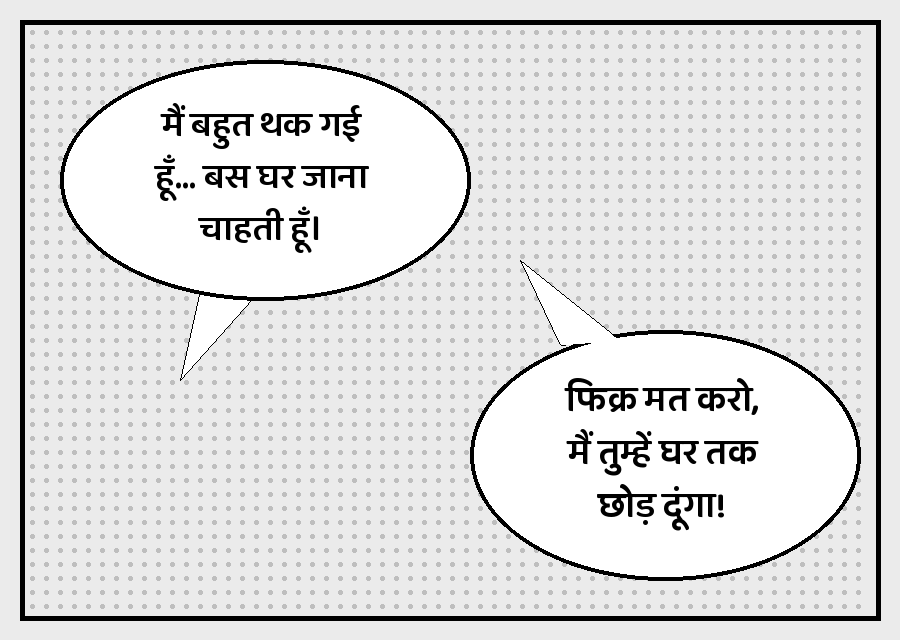
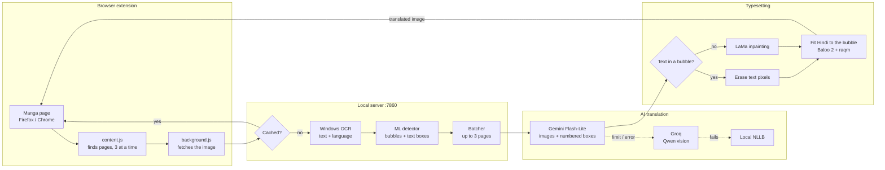

<div align="center">

# Manga Translator

**Read manga, manhwa and comics in natural, casual Hindi, right in your browser.**

Japanese · Korean · Chinese · English → हिन्दी

[](https://github.com/jitendra205saini/Manga-Translator/releases/tag/v2.0.0)
[](https://www.python.org/downloads/)
[](#requirements)
[](#installation)
[](#installation)
[](#tech-stack)
[](LICENSE)

[`manga`](https://github.com/topics/manga) [`manga-translator`](https://github.com/topics/manga-translator) [`manhwa`](https://github.com/topics/manhwa) [`comics`](https://github.com/topics/comics) [`translation`](https://github.com/topics/translation) [`hindi`](https://github.com/topics/hindi) [`ocr`](https://github.com/topics/ocr) [`gemini`](https://github.com/topics/gemini) [`groq`](https://github.com/topics/groq) [`llm`](https://github.com/topics/llm) [`browser-extension`](https://github.com/topics/browser-extension) [`firefox-extension`](https://github.com/topics/firefox-extension) [`chrome-extension`](https://github.com/topics/chrome-extension) [`fastapi`](https://github.com/topics/fastapi) [`python`](https://github.com/topics/python) [`opencv`](https://github.com/topics/opencv)

**English** | [Hinglish](README.hinglish.md)

[Features](#features) · [How it works](#how-it-works) · [Installation](#installation) · [Usage](#usage) · [Configuration](#configuration) · [Troubleshooting](#troubleshooting)

</div>

---

<div align="center">

| Before | After |
|---|---|
|  |  |

*Demo page made for this README. The speaker on the left is a girl ("थक गई"), on the right a boy ("छोड़ दूंगा").*

</div>


## Overview

**Manga Translator** is a free, self-hosted tool that translates manga pages while you read them.
A browser extension sends each page to a small server running on your own PC. The server reads the text,
translates it into everyday Hindi with an AI model, erases the original text and draws the Hindi back
into the speech bubbles, so the page looks as if it had been published in Hindi.

Unlike word-for-word translators, it looks at the page image to work out **who is speaking**, so the Hindi
uses the correct gender: a girl says *"मैं थक गई"*, a boy says *"मैं थक गया"*.

## Features

| Feature | Details |
|---|---|
| **Casual Hindi** | Natural spoken Hindi like anime dubs, not formal or bookish Hindi |
| **Gender-aware** | Verbs match the speaker and the person being addressed |
| **Character memory** | Remembers each character's gender per series (`memory.json`) |
| **4 source languages** | Japanese, Korean, Chinese (Simplified / Traditional) and English, with auto-detect |
| **ML bubble detection** | An RT-DETR model finds bubbles, text inside bubbles and text on artwork, in about 0.1 s per page on the GPU |
| **Clean typesetting** | Erases only the text pixels, rebuilds artwork with LaMa inpainting and fits Hindi to the bubble shape in a comic-style font |
| **Fallback chain** | Gemini → Groq (Qwen vision model, also sees the image) → local NLLB, so reading never stops when a free limit runs out |
| **Firefox & Chrome** | Manifest V3 extension that works on any site, with an "always on for this site" option |
| **Fast reading** | Prefetches upcoming pages, translates 3 pages in parallel, erases text while the AI is answering, remembers each series' language and caches results on disk |
| **Saves free quota** | Sends up to 3 pages in one AI request, so the free daily limit covers about 3 times more pages |
| **Original / Hindi toggle** | Press **Alt+O** to flip every page back to the original and again to Hindi |
| **Local first** | Runs on `127.0.0.1`. API keys stay on your PC and are never committed |

## How it works



Each translated page is cached on disk, and character genders are remembered per series in `memory.json`.
Press **Alt+O** to switch between the original and the Hindi page.

## Tech stack

| Layer | Technology |
|---|---|
| Browser extension | JavaScript, Manifest V3 (Firefox 128+ / Chrome) |
| Server | Python 3.13, FastAPI, Uvicorn |
| OCR | Windows 11 built-in OCR (`winrt`) |
| Bubble / text detection | `ogkalu/comic-text-and-bubble-detector` (RT-DETR-v2, ONNX Runtime + DirectML), OpenCV fallback |
| Inpainting | LaMa (`Carve/LaMa-ONNX`), OpenCV fallback |
| Translation | Google Gemini Flash-Lite, Groq (`openai/gpt-oss-120b`), Meta NLLB-200 600M (offline) |
| Rendering | Pillow + libraqm / FriBiDi, Baloo 2 (Noto Sans Devanagari fallback) |

## Project structure

```
manga-translator/
├── extension/                 # Firefox / Chrome extension
│   ├── manifest.json
│   ├── background.js          # fetches images, talks to the local server
│   ├── content.js             # finds manga images on the page, swaps in translations
│   └── popup.html / popup.js  # ON/OFF, language, "always on" and server status
├── server/
│   ├── server.py              # FastAPI app (POST /translate, GET /health)
│   ├── translator.py          # pipeline: OCR -> group -> bubbles -> translate -> render
│   ├── ocr_windows.py         # Windows OCR wrapper
│   ├── render.py              # bubble detection, text erasing and Hindi typesetting
│   ├── llm.py                 # Gemini / Groq prompts, fallback, character memory
│   ├── nllb.py                # offline NLLB fallback
│   ├── detector.py            # ML bubble / text detector (ONNX, DirectML GPU)
│   ├── inpaint.py             # LaMa inpainting for text on artwork
│   ├── config.example.json    # copy to config.json and add your keys
│   └── fonts/
├── SETUP.bat                  # one-time setup
├── START_SERVER.bat           # start the local server
└── INSTALL_OCR_LANGUAGES.bat  # install Windows OCR language packs
```

## Installation

### Requirements

- Windows 11, for the built-in OCR
- Python 3.13 with PyTorch installed. An NVIDIA GPU is optional; it is only used by the NLLB fallback.
- Firefox 128+ or Chrome
- A free [Gemini API key](https://aistudio.google.com/apikey) and/or a free [Groq API key](https://console.groq.com/keys)

### Steps

**1. Install the OCR language packs** (run as administrator)

```bat
INSTALL_OCR_LANGUAGES.bat
```

**2. Run the setup.** This creates a virtual environment, installs the dependencies and downloads the
Devanagari fonts, the FriBiDi DLL needed for correct Hindi shaping, the ML detector and LaMa models
(about 380 MB) and the NLLB model.

```bat
SETUP.bat
```

**3. Add your API keys.** Copy `server\config.example.json` to `server\config.json` and paste your keys:

```json
{
  "gemini": { "api_key": "AIza..." },
  "groq":   { "api_key": "gsk_..." }
}
```

> [!IMPORTANT]
> Never share your API keys. `server/config.json` is listed in `.gitignore` and is never committed.

**4. Load the extension**

- **Chrome:** open `chrome://extensions`, enable *Developer mode*, click *Load unpacked* and select the `extension` folder.
- **Firefox:** open `about:debugging#/runtime/this-firefox`, click *Load Temporary Add-on* and select `extension/manifest.json`.
  Then open the extension popup and click **"Pehle permission do"** to grant site access.

> [!NOTE]
> Firefox removes temporary add-ons when it closes. Load it again after each restart, or sign the add-on through Mozilla to install it permanently.

## Usage

1. Start the server:
   ```bat
   START_SERVER.bat
   ```
2. Open a manga chapter in your browser.
3. Click the extension icon and switch it **ON**, or press **Alt+T**.
4. Scroll normally. Pages get an orange outline while they are being translated, then the Hindi version replaces them.

**Tips**

- Tick **"Is site par hamesha ON"** to turn the translator on automatically for that site.
- Pick a fixed language instead of **Auto** to make pages translate faster.
- Press **Alt+O** (or the popup button) to compare with the original page.

## Configuration

`server/config.json`

| Key | Default | Description |
|---|---|---|
| `providers` | `["gemini", "groq", "nllb"]` | Order in which translators are tried |
| `gemini.api_key` | `""` | Your Gemini key (or set the `GEMINI_API_KEY` environment variable) |
| `gemini.model` | Flash-Lite models | One model or a list. The next one is tried if a model is busy |
| `groq.api_key` | `""` | Your Groq key (or set `GROQ_API_KEY`) |
| `groq.model` | `["qwen/qwen3.8-27b", "openai/gpt-oss-120b"]` | One model or a list, tried in order |
| `groq.vision_models` | `["qwen/qwen3.8-27b"]` | Models that also receive the page image, so gender works on the fallback too |
| `image_max_side` | `1024` | Size of the image sent to the AI. Smaller uses fewer tokens |
| `batch_pages` | `3` | Up to this many pages are translated in one AI request |
| `batch_wait` | `1.5` | Seconds to wait for more pages before sending a request |

## Troubleshooting

| Problem | Fix |
|---|---|
| Popup says the server is down | Run `START_SERVER.bat` and keep its window open |
| Hindi matras look broken | Run `SETUP.bat` again, then `check_setup.py` should show `Hindi shaping: OK (raqm)` |
| Pages stay in English | Check the server window for errors. Gemini's free daily limit may be used up; Groq is used next |
| Wrong gender for a character | Edit that character in `server/memory.json` (`"m"` or `"f"`) |
| "model not found" in the log | Change the model name in `config.json` |

To check the setup at any time:

```bat
cd server
..\manga_env\Scripts\python.exe check_setup.py
```

For debugging, the server log shows the detected language, the provider used and each bubble's
gender (`m` / `f` / `u`). The original and translated versions of the last 40 pages are saved in `server/debug/`.

## Known limitations

- Windows OCR struggles with very stylized, italic or vertical text. Gemini reads those bubbles from the image instead.
- LaMa inpainting runs on the CPU (about 2 s per text block on artwork), because it does not run on DirectML. It runs while the AI request is in flight, so it adds little extra time.
- Very small bubbles get small Hindi text, because Hindi is usually longer than the English it replaces.
- Gemini's free tier has a daily request limit, which is set per project in Google AI Studio.

## Roadmap

- [x] ML bubble and text detector (`comic-text-and-bubble-detector`)
- [x] LaMa inpainting for text drawn on artwork
- [x] Several pages per AI request to stretch the free limit
- [x] Disk cache, so re-opened chapters cost no requests
- [x] Comic-style Devanagari font (Baloo 2)
- [x] Original / Hindi toggle (Alt+O)
- [ ] Better OCR: `manga-ocr` for Japanese, PaddleOCR for English / Korean / Chinese
- [ ] Signed Firefox add-on (permanent install)

## License

Released under the [MIT License](LICENSE). The bundled fonts (Noto Sans Devanagari, Baloo 2) are under the SIL Open Font License, and the downloaded models are under Apache-2.0.

## Acknowledgements

- [Google Gemini](https://ai.google.dev/), [Groq](https://groq.com/) and [Meta NLLB-200](https://huggingface.co/facebook/nllb-200-distilled-600M) for translation
- [Baloo 2](https://fonts.google.com/specimen/Baloo+2) and [Noto Sans Devanagari](https://fonts.google.com/noto/specimen/Noto+Sans+Devanagari) for the Hindi fonts
- [ogkalu/comic-text-and-bubble-detector](https://huggingface.co/ogkalu/comic-text-and-bubble-detector) for bubble and text detection
- [LaMa](https://github.com/advimman/lama) ([ONNX version by Carve](https://huggingface.co/Carve/LaMa-ONNX)) for inpainting
- Inspired by [manga-image-translator](https://github.com/zyddnys/manga-image-translator), [BallonsTranslator](https://github.com/dmMaze/BallonsTranslator) and [comic-translate](https://github.com/ogkalu2/comic-translate)

---

<div align="center">

Made by [jitendra205saini](https://github.com/jitendra205saini)

</div>
