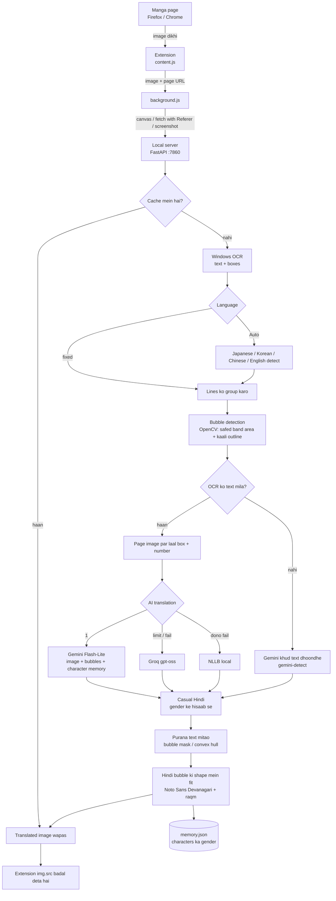

# Manga Translator (JA / KO / ZH / EN -> casual Hindi)

## Description

**Manga Translator** ek free, local tool hai jo browser mein manga, manhwa aur comics padhte waqt pages ko
apne aap **casual (bolchaal wali) Hindi** mein translate karke usi image par likh deta hai, jaise page pehle se Hindi mein ho.

- Japanese, Korean, Chinese aur English pages support
- Bolne wale ke **gender ke hisaab se** Hindi ("main thak gayi" / "main thak gaya")
- Shuddh Hindi nahi, roz ki bolchaal wali Hindi
- Purana text mitakar Hindi bubble ke andar fit hoti hai
- Firefox aur Chrome dono par, kisi bhi site par

Translation Gemini se hoti hai (image dekhkar, bolne wale ke gender ke hisaab se). Gemini na chale to Groq,
aur dono na chalein to local NLLB (offline backup).

**Topics / Tags:** `manga` `manga-translator` `manhwa` `comics` `translation` `hindi` `ocr` `gemini` `groq` `llm`
`browser-extension` `firefox-extension` `chrome-extension` `fastapi` `python` `opencv`

## Kaise kaam karta hai

## Ek baar
1. `INSTALL_OCR_LANGUAGES.bat` (admin)
2. `SETUP.bat`
3. API keys lo (dono free) aur `server\config.example.json` ko copy karke `server\config.json` banao, usme keys daalo:
   - Gemini: https://aistudio.google.com/apikey -> Create API key
   - Groq:   https://console.groq.com/keys -> Create API Key

   Key kisi ko mat dikhana. `config.json` git mein push nahi hoti.
4. Extension load karo:
   - **Chrome:** `chrome://extensions` -> Developer mode -> Load unpacked -> `extension` folder
   - **Firefox:** `about:debugging#/runtime/this-firefox` -> Load Temporary Add-on -> `extension\manifest.json`,
     phir popup mein "Pehle permission do" dabao

## Har baar
1. `START_SERVER.bat`
2. Manga tab par extension icon -> ON (ya **Alt+T**)
   - "Is site par hamesha ON" tick karo to us site par apne aap chalega
   - Language Auto ki jagah fix karoge to page jaldi translate hoga

Server log mein har page ki language, provider (gemini/groq/nllb), har bubble ka gender (m/f/u) aur translation dikhti hai.
Characters ka gender `server\memory.json` mein yaad rehta hai (galat ho to wahan se badal sakte ho).
Aakhri 40 pages ka original + translated `server\debug\` mein save hota hai.
