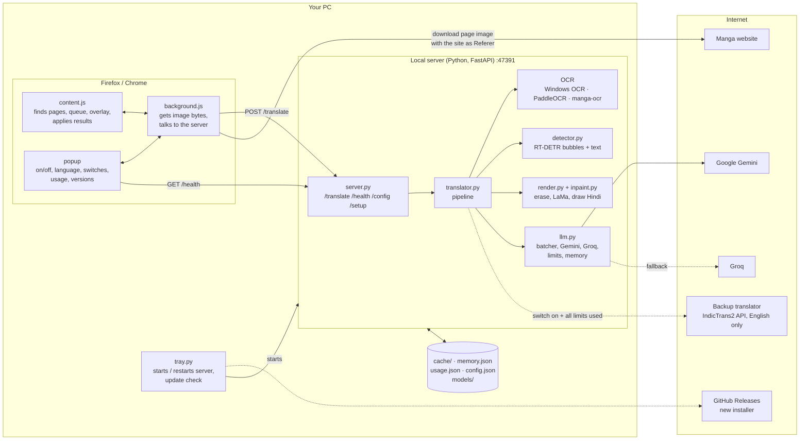
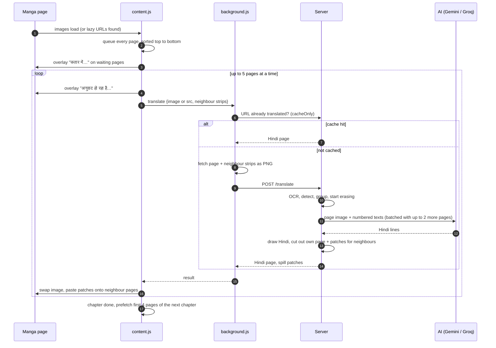
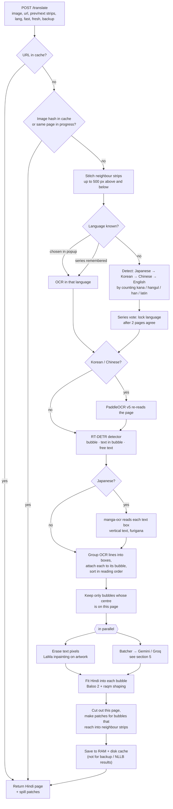
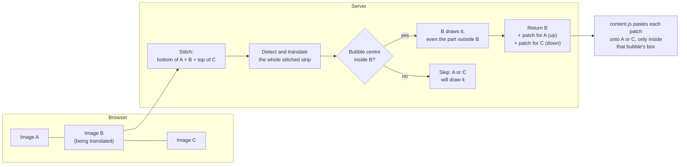
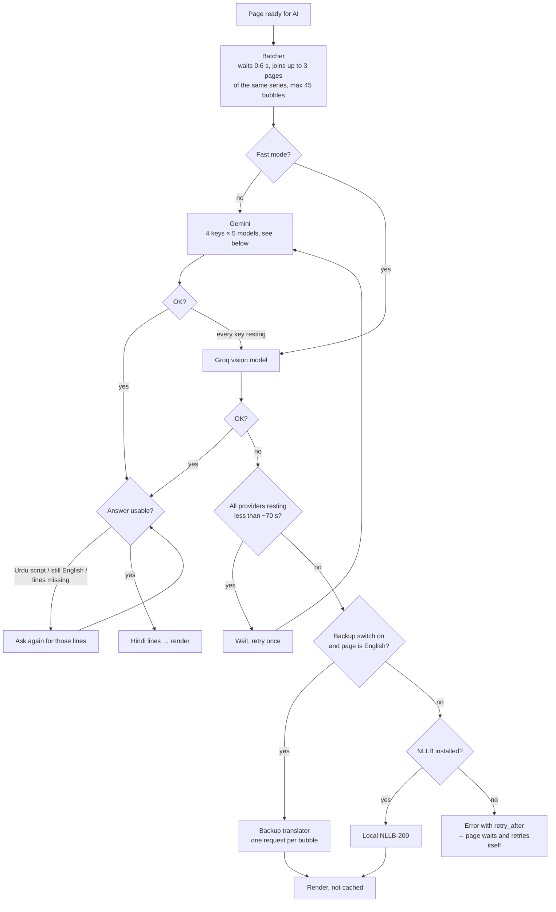
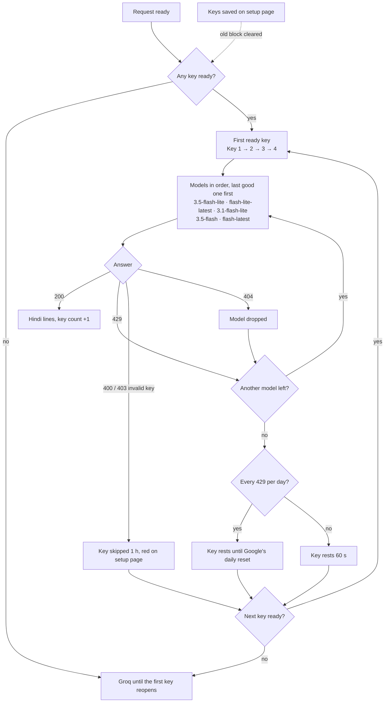
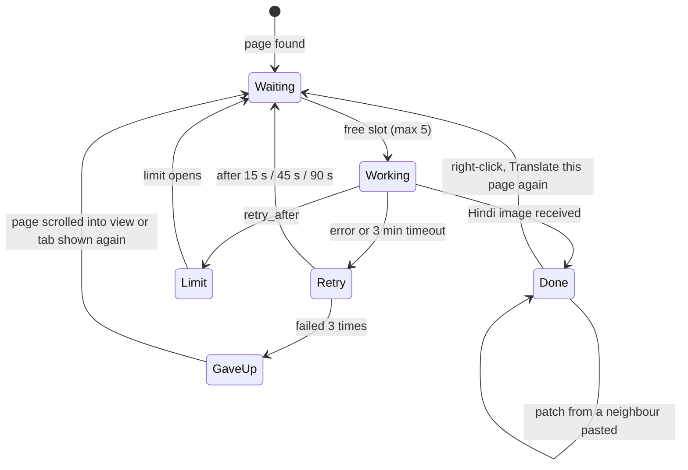

# Architecture

This page explains how Manga Translator works inside: which parts exist, how a page travels from the browser to the server and back, and what happens when the free AI limits run out. For installing and using the tool, see the [README](../README.md).

- [1. System overview](#1-system-overview)
- [2. Life of one page](#2-life-of-one-page)
- [3. Server pipeline](#3-server-pipeline)
- [4. Webtoon strips and split bubbles](#4-webtoon-strips-and-split-bubbles)
- [5. AI providers, limits and fallbacks](#5-ai-providers-limits-and-fallbacks) (including how Gemini keys and models switch)
- [6. Page states in the extension](#6-page-states-in-the-extension)
- [7. Caching](#7-caching)
- [8. Files](#8-files)
- [9. Data on disk](#9-data-on-disk)

## 1. System overview

Everything runs on your own PC except the AI calls. The browser extension finds manga pages and sends them to a local server on `127.0.0.1:47391`. The server does OCR, detection, erasing and drawing locally, and only sends text plus a small image to the AI.

## 2. Life of one page

What happens from the moment a chapter opens until a Hindi page is on screen.

If the server answers with `retry_after` (every AI limit is used up), the page shows the wait time and is sent again by itself when the limit opens. See [section 6](#6-page-states-in-the-extension).

## 3. Server pipeline

`translator.translate_page()` runs these steps for every page.

Notes:

- **OCR order.** Windows OCR runs first because it is fast and already on Windows 11. PaddleOCR replaces its result for Korean and Chinese, where it is much more accurate. manga-ocr replaces it for Japanese.
- **Erasing and AI at the same time.** Erasing does not need the translation, so it runs while waiting for the AI.
- **Reading order.** Boxes are sorted in rows from top to bottom, right to left for Japanese and left to right for everything else, so the AI sees the dialogue in order.

## 4. Webtoon strips and split bubbles

Many sites cut one long webtoon into several images. A speech bubble can then be split in two, and each half alone is unreadable. The extension finds images stacked directly above and below (same width, gap under 40 px, up to about 500 px) and sends them along.

Every bubble is owned by exactly one image (the one holding its centre), so it is translated once and never drawn twice. Patches can arrive before or after the neighbour itself is translated; `content.js` keeps them and redraws the neighbour whenever either side changes. Thin strips between pages (40 px and up) are translated too, because a bubble can sit right on them.

## 5. AI providers, limits and fallbacks

The diagram shows the normal order. With **Fast mode** on, the order flips: Groq is tried first and Gemini is its backup.

Rate pacing keeps requests under the free limits: about 14 requests per minute per Gemini key and 25 per minute for Groq. The daily Gemini count in the popup follows Google's day, which resets at midnight Pacific time (around 1:30 PM in India).

Each request also carries the series memory: character names with their gender and fixed Hindi spelling, and the last 8 translated lines, so verbs keep the right gender and names are spelled the same on every page.

### How Gemini keys and models switch

Google's free limit is per project **and** model. The server keeps a state for every key (ready, resting for a minute, done for the day, not valid) and treats Gemini as available while any key is ready.

The **Check Gemini keys** button on the setup page asks Google whether each key is valid (a model list call, which does not use any translation quota).

## 6. Page states in the extension

| State | Overlay on the page |
|---|---|
| Waiting | "कतार में…" (light shade) |
| Working | spinner + "अनुवाद हो रहा है…" (dark shade) |
| Limit | "AI ki free limit khatam — ~N min baad apne aap" |
| Done | no overlay, Hindi image shown (Alt+O shows the original) |

Pages are always taken top to bottom, wherever you scroll. A hidden tab keeps working, but never takes screenshots, because a screenshot of a hidden tab would capture the wrong page.

## 7. Caching

| Level | Key | Where | Purpose |
|---|---|---|---|
| URL | image URL + language | RAM + `server/cache/` | next chapter prefetch: the page is not even downloaded again |
| Content | MD5 of the image (+ neighbour strips) + language | RAM (20 pages) + `server/cache/` | same page from any URL |
| In progress | same as content | RAM | two requests for one page share one translation |

Results from the backup translator and from NLLB are not cached, so the AI translates those pages properly later. "Translate this page again" skips all caches.

## 8. Files

| File | Role |
|---|---|
| `extension/content.js` | Finds pages (including lazy ones), queue in reading order, overlays, webtoon neighbours and patches, retries, next-chapter prefetch, Alt+O |
| `extension/background.js` | Downloads images with the right Referer, screenshot fallback, talks to the server, right-click menu |
| `extension/popup.html`, `popup.js` | On/off, language, Fast mode, Backup switch, progress, usage, versions |
| `server/server.py` | FastAPI app: `/translate`, `/health`, `/config`, `/setup`; only extensions and the setup page may call it |
| `server/translator.py` | The pipeline in section 3, stitching, ownership, caches |
| `server/ocr_windows.py` | Windows 11 OCR |
| `server/paddle_ocr.py` | PaddleOCR v5 (ONNX) for Korean and Chinese |
| `server/mangaocr.py` | manga-ocr (ONNX) for Japanese |
| `server/detector.py` | RT-DETR-v2 bubble and text detector (ONNX, DirectML GPU) |
| `server/inpaint.py` | Manga-tuned LaMa inpainting (ONNX) and text masks |
| `server/render.py` | Erasing, fitting and drawing Hindi text |
| `server/llm.py` | Prompt, batcher, Gemini / Groq calls, key rotation, pacing, limits, series memory, usage |
| `server/backup_api.py` | Backup translator (English only) |
| `server/nllb.py` | Optional offline NLLB-200 |
| `server/tray.py`, `run.py` | Tray icon, starting and restarting the server, update check |
| `installer/` | Inno Setup script, install / stop scripts, signed Firefox add-on |

## 9. Data on disk

All inside the install folder (`%LOCALAPPDATA%\Programs\Manga Translator\server`). None of it is uploaded to GitHub.

| File | Contents |
|---|---|
| `config.json` | API keys and settings |
| `memory.json` | Per series: character genders, Hindi name spellings and recent lines |
| `usage.json` | Today's page and request counts |
| `cache/` | Translated pages |
| `models/` | Detector, LaMa, manga-ocr and PaddleOCR models |
| `server.log` | Server log, for troubleshooting |
